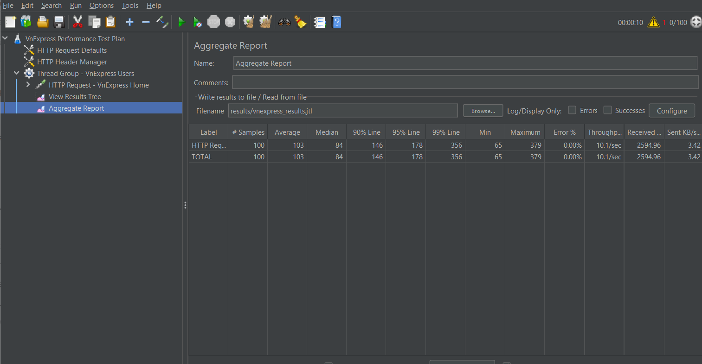
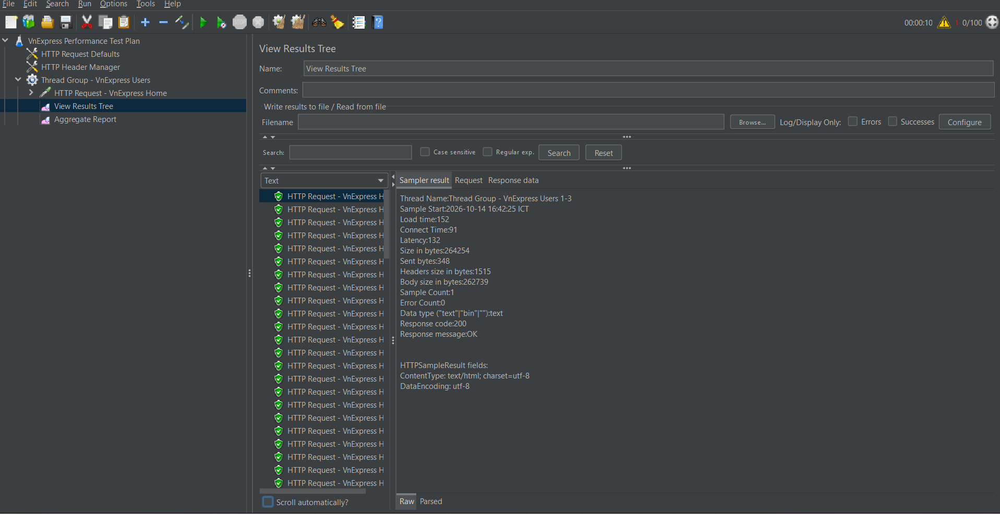

# JMeter
## Kiểm tra hiệu năng trang web
### Mục tiêu:

- Sử dụng jMeter để tạo một kịch bản kiểm tra mô phỏng người dùng truy cập trang web https://vnexpress.net/.
- Chạy kịch bản kiểm tra và ghi lại kết quả.
- Phân tích kết quả kiểm tra, bao gồm thời gian phản hồi, số lượng yêu cầu thành công, số lượng yêu cầu thất bại, v.v.
- Dựa trên kết quả phân tích, đưa ra kết luận về hiệu năng của trang web.
### Kịch bản kiểm tra:

- Thread Group:
  - Số lượng thread: 100
  - Thời gian chạy: 60 giây
  - Ramp-up period: 10 giây
- HTTP Request:
  - URL: https://vnexpress.net/
  - Method: GET
  - Content encoding: UTF-8
- Listeners:
  - View Results Tree
  - Aggregate Report
### Kết quả kiểm tra:

### Phân tích kết quả kiểm tra:

- Số lượng yêu cầu thành công: 100/100 = 100%
- Số lượng yêu cầu thất bại: 0/100 = 0%
- Thời gian phản hồi trung bình: 103 ms
- Thời gian phản hồi trung vị: 84 ms
- Thời gian phản hồi percentil 90: 146 ms
- Chuyển tải: 10,1 yêu cầu/giây
### Kết luận:

Trang web https://vnexpress.net/ có hiệu năng rất tốt. Số lượng yêu cầu thành công đạt tuyệt đối (100%), số lượng yêu cầu thất bại là 0%. Thời gian phản hồi trung bình, trung vị và percentil 90 đều ở mức thấp (dưới 150 ms). Chuyển tải của trang web đạt 10,1 yêu cầu/giây ổn định.
### Hình ảnh tổng quát

